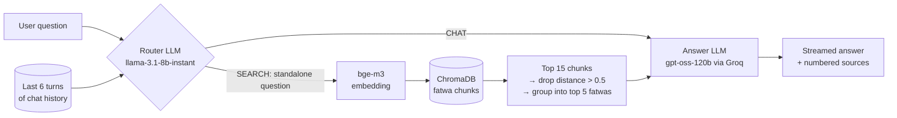

# 🕌 Online Efteely

**A production RAG chatbot that answers Islamic (fiqh) questions from 50,000+ real fatwas, and cites the exact fatwas it used.**

<a href="https://huggingface.co/spaces/H-Salah/online-efteely"></a>
<a href="https://www.kaggle.com/datasets/hazemmosalah/50k-islamic-fatwa-q-and-a-dataset-arabic"></a>


## The problem

People search for religious rulings and get either generic chatbot answers with no source, or long forum threads. A general LLM will happily invent a ruling. Efteely only answers from real, published fatwas, shows the source for every claim, and says clearly when it found nothing instead of guessing.

## What it does

- **Answers from real sources only.** The model is instructed to use the retrieved fatwas and nothing else.
- **Cites every claim.** Answers carry `[1]`, `[2]` markers that match a numbered list of source links under the answer.
- **Understands follow-ups.** A small router model rewrites "and what about travelling?" into a standalone question before searching.
- **Skips search for small talk.** Greetings and thanks are answered directly, without a retrieval call.
- **Refuses to guess.** If no fatwa is close enough, it says so and points the user to a scholar.

## How it works



**Indexing (offline, once):** [`notebook/OFCB.ipynb`](notebook/OFCB.ipynb) splits each fatwa into ~1,200-character chunks (150 overlap) with the question prepended to every chunk, embeds them with `BAAI/bge-m3` on a Colab T4, and uploads the Chroma index to a [Hugging Face dataset](https://huggingface.co/datasets/H-Salah/online-efteely-chroma).

**Serving:** on startup the app downloads that index once, then handles each message in two LLM calls: one to the router, one for the answer.

## Tech stack

| Layer | Tools |
|:--|:--|
| Data | 50K+ fatwas scraped from Bin Baz, IslamQA and IslamWeb (BeautifulSoup), cleaned with pandas |
| Embeddings | `BAAI/bge-m3` (sentence-transformers), normalized, cosine distance |
| Vector store | ChromaDB, hosted as a Hugging Face dataset |
| LLMs | Groq: `gpt-oss-120b` (answers), `llama-3.1-8b-instant` (routing, with fallback to the answer model) |
| Orchestration | LangChain (prompt templates, streaming, fallbacks) |
| Observability | LangSmith tracing of retrieval and LLM calls |
| App & deploy | Streamlit on Hugging Face Spaces, synced from GitHub by a GitHub Action |

## Run it locally

```bash
git clone https://github.com/h-salah1117/Online-Efteely.git
cd Online-Efteely
python -m venv venv && source venv/bin/activate   # Windows: venv\Scripts\activate
pip install -r requirements.txt
```

Create `.streamlit/secrets.toml`:

```toml
GROQ_API_KEY = "your-groq-key"        # required
# HF_TOKEN = "..."                    # only if the index dataset is private
# LANGSMITH_API_KEY = "..."           # optional tracing
# LANGSMITH_TRACING = "true"
# LANGSMITH_PROJECT = "online-efteely"
```

```bash
streamlit run app.py
```

The first start downloads the Chroma index and the bge-m3 model, so it takes a few minutes.

The index is downloaded to `/tmp/chroma_db` by default. If you already have it locally, set `CHROMA_PATH` to the folder that contains `chroma_db/` and create an empty `.download_complete_bge-m3-chunks-v1` file in it to skip the download.

## Key settings (in `rag_core.py`)

| Setting | Value | Meaning |
|:--|:--|:--|
| `RETRIEVE_K` | 15 | chunks fetched per question |
| `TOP_FATWAS` | 5 | distinct fatwas passed to the LLM |
| `MAX_DISTANCE` | 0.5 | chunks farther than this are ignored |
| `INDEX_VERSION` | `bge-m3-chunks-v1` | bump to force a re-download after re-indexing |

## Project structure

```
├── app.py                         # Streamlit UI: chat, router, answer, sources
├── rag_core.py                    # Index download, embeddings, retrieval, settings
├── notebook/OFCB.ipynb            # Indexing pipeline (chunk → embed → upload)
├── requirements.txt
├── .streamlit/config.toml
└── .github/workflows/
    └── sync-to-hf-space.yml       # Deploys every push on main to the HF Space
```

## How it evolved

| | v1: [Efteely Offline](https://github.com/h-salah1117/Efteely-Islamic-Chatbot) | v2: Online Efteely |
|:--|:--|:--|
| Embeddings | CAMeL-Lab Arabic BERT, whole questions | bge-m3, chunked question + answer |
| Retrieval | Cosine top-5 over question embeddings | Chroma top-15 chunks, distance filter, grouped per fatwa |
| LLM | Gemma 3 (local, Ollama) | gpt-oss-120b on Groq |
| Conversation | Single question | History + standalone-question rewriting |
| Sources | Link to the top fatwa | Inline `[n]` citations for every fatwa used |
| Deployment | Local Flask app | Public Streamlit app, auto-deployed |

## Evaluation

🚧 **In progress.** Right now, retrieval is only sanity-checked in the indexing notebook: three test questions, one of them deliberately unrelated. Next up:

- a held-out set of reworded questions to measure retrieval hit@5 and MRR
- a comparison of embedding and retrieval setups (e5 vs bge-m3 vs hybrid BM25 + reranker)
- checks for answer faithfulness and citation accuracy

## Disclaimer

Efteely is for educational and technical purposes. Its answers are not religious rulings. Always confirm with a qualified scholar.

## License

MIT
